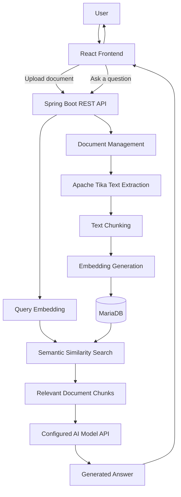
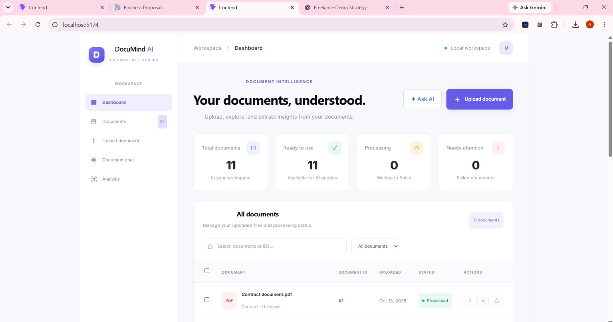
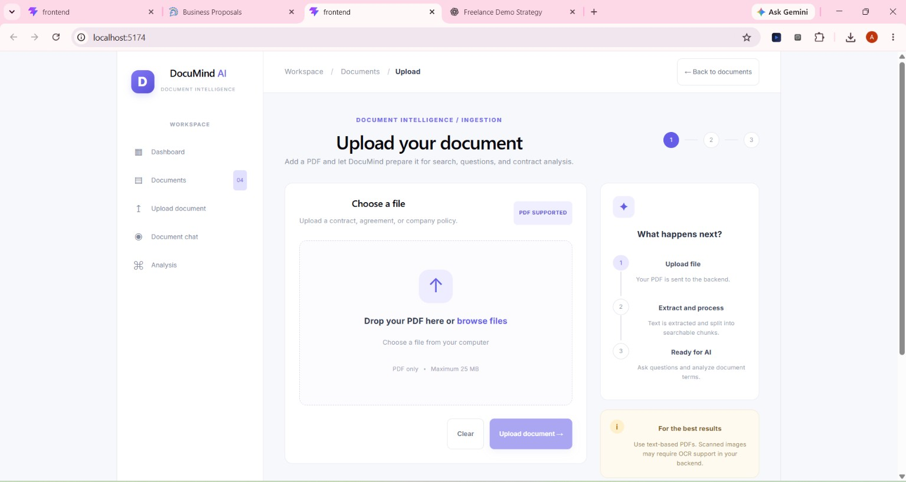
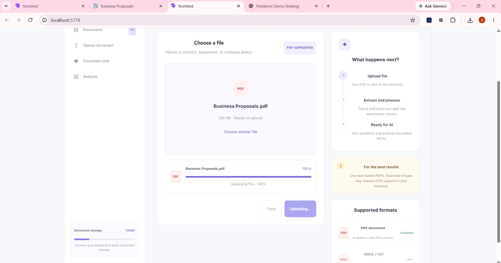
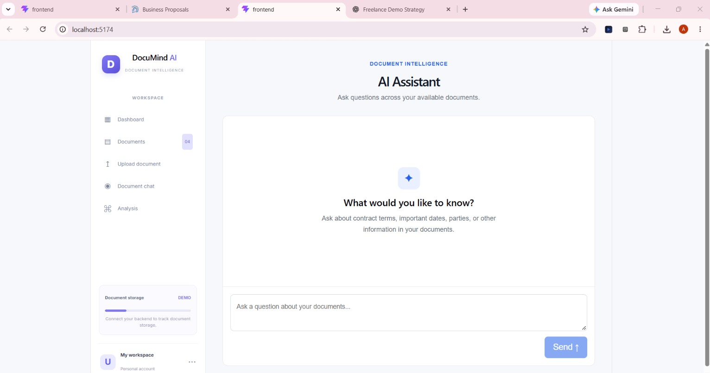
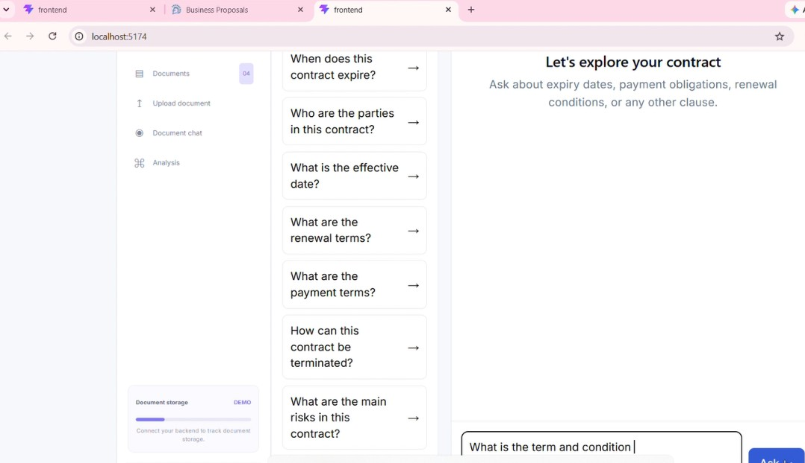
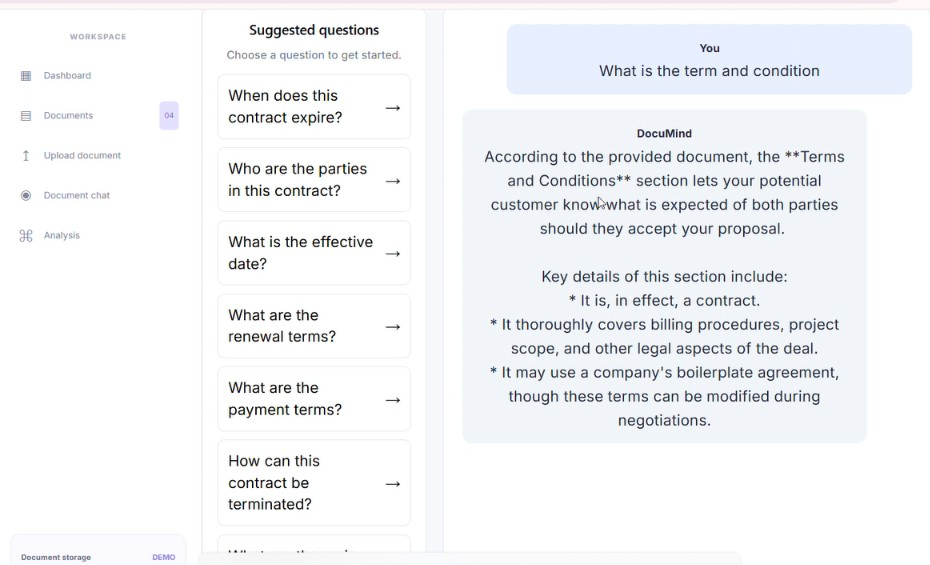
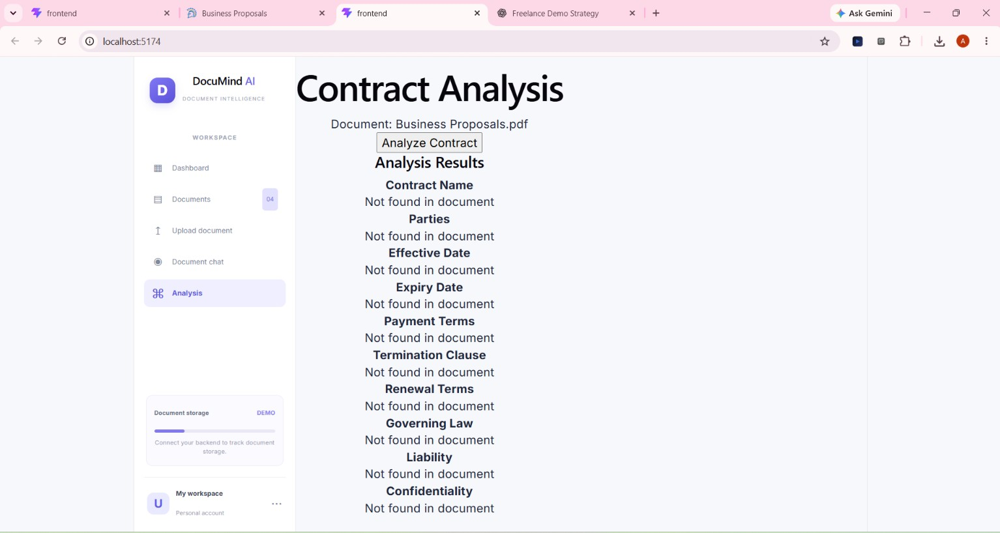

<<<<<<< HEAD
# DocMint AI — AI-Powered Document Intelligence

**Project type:** Full-stack AI application  
**Frontend:** React  
**Backend:** Java, Spring Boot  
**Document processing:** Apache Tika  
**Database:** MariaDB  
**AI integration:** Configured AI API for embeddings and answer generation

## 1. Overview

DocMint AI is a document intelligence application designed to help users retrieve information from business documents through natural-language questions.

The application combines document processing, text chunking, semantic retrieval and AI-generated responses in a full-stack workflow.

## 2. Problem Statement

Searching lengthy documents manually can be time-consuming. Finding particular terms, dates, conditions or other details often requires repeatedly scanning the original document.

DocMint AI explores how document processing and AI-assisted retrieval can make this workflow more convenient.


## 3. Key Features

### 3.1 Document Upload and Management
Users can upload documents through the application interface for processing and analysis. The platform manages uploaded documents as the starting point for the document intelligence workflow.

### 3.2 PDF Text Extraction
The backend uses **Apache Tika** to extract text from PDF documents, making their contents available for downstream processing and AI-powered analysis.

### 3.3 Document Chunking and Storage
Extracted document text is divided into smaller chunks to support efficient retrieval. The application stores document data and processed chunks in **MariaDB**, providing a persistent foundation for document search and question answering.

### 3.4 Semantic Retrieval Using Embeddings
The application uses embeddings to represent document content and retrieve relevant chunks based on the meaning of a user's query. This helps the system identify contextually relevant information rather than relying exclusively on exact keyword matches.

### 3.5 Natural-Language Question Answering
Users can ask questions about their documents in natural language. The backend retrieves relevant document context and uses an AI language model to generate answers grounded in the retrieved content.

### 3.6 Processing Status and Error Handling
The application tracks document-processing progress and handles processing failures, helping users understand the state of their uploaded documents and identify documents that could not be processed successfully.

### 3.7 Structured Document Extraction
DocMint AI supports extracting structured information from documents for more targeted analysis. This capability is intended to make important details easier to identify and work with, rather than requiring users to search through the entire document manually.

## 4. Technology Stack

DocMint AI is built using a full-stack architecture that combines a React frontend, a Java Spring Boot backend, document-processing tools, a relational database, and AI-powered semantic retrieval.

| Technology | Purpose |
|---|---|
| **React** | Builds the user interface for uploading documents, viewing document information, and interacting with the document Q&A interface. |
| **Java** | Implements the backend application logic and document-processing workflow. |
| **Spring Boot** | Provides backend APIs and coordinates document processing, retrieval, and AI-powered question answering. |
| **Apache Tika** | Extracts text and metadata from supported documents, including PDFs. |
| **MariaDB** | Persists document information, extracted content, and processed document chunks. |
| **Embeddings** | Represent document content and user queries as vectors to support semantic retrieval. |
| **Spring AI** | Integrates AI capabilities into the Spring Boot application, including model interaction and embedding workflows where configured. |
| **Configured AI API** | Provides the AI model capabilities used by the current application. The specific provider and models depend on the application's configuration. |
| **Maven** | Manages backend dependencies and the Java build process. |
| **Git and GitHub** | Support source-code version control and project collaboration. |

### Technology Integration

The React frontend communicates with the Spring Boot backend through HTTP APIs. The backend processes uploaded documents, extracts their text, divides the content into chunks, and stores the resulting data in MariaDB. Embeddings support semantic retrieval, allowing the application to retrieve relevant document content when a user asks a question. The configured AI model then uses the retrieved context to generate a response.

## 5. Architecture

DocMint AI follows a full-stack architecture in which the React frontend communicates with a Spring Boot backend, while document storage, text processing, semantic retrieval, and AI-powered question answering are handled by backend services.

### 5.1 High-Level Architecture



### 5.2 Document Ingestion Workflow

When a user uploads a document, the application processes its content through the following stages:

1. **Upload:** The React frontend sends the document to the Spring Boot backend.
2. **Text extraction:** Apache Tika extracts text from the PDF.
3. **Chunking:** The extracted content is divided into smaller text segments for retrieval.
4. **Embedding generation:** The application generates vector representations of the document chunks using the configured embedding model.
5. **Storage:** Document information and processed chunks are stored in MariaDB, along with the associated data required by the application.

### 5.3 Question-Answering Workflow

When a user submits a question:

1. **Question submission:** The frontend sends the question and retrieval settings to the backend.
2. **Query representation:** The backend generates an embedding for the question using the configured embedding model.
3. **Semantic retrieval:** The application searches for document chunks that are semantically similar to the question.
4. **Context preparation:** Relevant retrieved chunks are prepared as context for the AI model.
5. **Answer generation:** The configured AI model API generates a response using the supplied context.
6. **Response display:** The backend returns the answer to the frontend for display.

### 5.4 Architecture Design Considerations

- **Separation of concerns:** The React frontend handles user interaction, while Spring Boot coordinates backend processing and AI integration.
- **Persistent storage:** MariaDB stores document-related information and processed content.
- **Context-aware retrieval:** Embeddings help identify relevant passages before answer generation.
- **Configurable retrieval:** The backend supports controlling the number of chunks retrieved for a query through the `topK` parameter.
- **AI integration:** The current implementation relies on a configured AI API, so an internet connection and valid API configuration may be required for AI operations.


## 6. Supported File Types

DocMint AI currently supports PDF documents for upload, text extraction, and AI-powered document analysis. Support for additional file formats is planned to make the platform useful for a wider range of document workflows.

### 6.1 Currently Supported

| File Format | Status | Description |
|---|---|---|
| PDF (`.pdf`) | Supported | Upload PDF documents, extract their text, and use the extracted content for semantic retrieval and question answering. |

### 6.2 Planned Support

| File Format | Status | Planned Capability |
|---|---|---|
| Plain Text (`.txt`) | Planned | Upload and process text files for document search and question answering. |
| Microsoft Word (`.docx`) | Planned | Extract and process the text of Word documents for document analysis and question answering. |

### 6.3 Future Improvements

The planned improvements include:

- Adding TXT and DOCX upload and text extraction support.
- Validating uploaded files and providing clear error messages for unsupported or invalid documents.
- Improving extraction reliability for complex document layouts.
- Extending document analysis to handle a wider range of business and professional documents.

Additional formats will be marked as supported once their upload, extraction, and question-answering workflows have been implemented and tested.

## 7. Demo, Screenshots, and Project Links

DocMint AI currently runs on my development machine. The following screenshots and demo video showcase its implemented PDF processing and AI-powered question-answering workflow.

### 7.1 Application Demo Video

The demonstration covers PDF upload, document processing, and natural-language question answering.

**Demo video:** [Watch the DocMint AI Demo](https://youtu.be/oXZSC34vDyI)

### 7.2 Application Screenshots

#### Dashboard



#### PDF Upload and Processing




#### Document Question Answering





### 7.3 Project Repository

- **GitHub Repository:** [View the source code](ADD_YOUR_GITHUB_REPOSITORY_LINK_HERE)
- **Setup Instructions:** See [Section 8: Local Setup](#8-local-setup).

### 7.4 Current Deployment and AI Model Status

The current version runs locally on my development machine and uses a configured AI API for AI-powered operations. It is not yet configured to let clients run all AI processing on their own systems.

Local AI model integration and a more accessible deployment workflow are planned improvements. The final approach will depend on hardware requirements, model performance, and deployment needs.

### 7.5 Demo Data and Privacy

The demonstration uses sample documents without confidential client information, personal data, API keys, or other secrets. The video represents the current implementation; planned capabilities are documented separately in the roadmap.

## 8. Local Setup

DocMint AI currently runs in a local development environment. The setup is intended for development and testing, with a simpler and more flexible installation process planned for future releases.

### Prerequisites

- Java JDK compatible with the backend project.
- Maven for building and running the Spring Boot backend.
- Node.js and npm for the React frontend.
- MariaDB for database storage.
- Valid AI API credentials for the currently configured AI provider.

### Running the Application

**1. Start the database**

Start MariaDB and ensure that the configured database and credentials are available.

**2. Start the backend**

Open a terminal in the backend project directory and run:

```bash
mvn spring-boot:run
```

Ensure that the database connection and AI provider configuration are correct.

**3. Start the frontend**

Open a separate terminal in the frontend directory and run:

```bash
npm install
npm run dev
```

**4. Test the application**

Open the frontend URL displayed in the terminal, upload a sample PDF, and ask a question about its contents.

### Future Setup Improvements

A more flexible setup process is planned to make DocMint AI easier to install and run outside the current development environment. This will be considered alongside local AI model integration and deployment requirements.

**Security:** Keep API keys, database passwords, and other credentials in local environment configuration. Never commit secrets to a public repository.


## 9. Current Limitations

DocMint AI currently demonstrates a working document-processing and question-answering workflow. The following limitations identify areas for further development.

### 9.1 Supported File Formats

The current implementation supports PDF documents. TXT and Microsoft Word document support are planned but have not yet been included in the supported-format list.

### 9.2 AI Model Deployment

The current version uses a configured AI API for AI-powered operations. It is not yet designed to run all inference locally on a user's computer.

Local model integration is planned to provide an alternative for users who prefer to run inference on their own hardware. This will require evaluating model performance, hardware requirements, and deployment complexity.

### 9.3 Deployment and Accessibility

The application currently runs in a local development environment. A deployment approach that allows external users to access the application reliably will require additional setup and testing.

### 9.4 Document Extraction Quality

Document extraction quality may vary depending on PDF structure, layout, scanned pages, tables, and other formatting characteristics. Additional testing and extraction improvements will help expand the range of documents the application can handle reliably.

### 9.5 Retrieval and Answer Quality

The relevance of retrieved passages and the quality of generated answers depend on document content, chunking strategy, embedding quality, retrieval settings, and the configured AI model. Further evaluation is needed to measure accuracy across different documents and question types.

### 9.6 Security and Production Readiness

Before production use, the application needs appropriate security, input validation, access controls, operational monitoring, and deployment hardening. These requirements should be validated according to the intended deployment environment and users.


## 10. Roadmap

DocMint AI will evolve based on user feedback, practical requirements, and testing.

### Planned Improvements

- **Additional document formats:** Add TXT and Microsoft Word (DOCX) support.
- **Local AI model integration:** Integrate a suitable local model to reduce reliance on external AI APIs and enable local inference where the user's hardware supports it.
- **User-driven features:** Prioritize additional document analysis, extraction, and workflow capabilities based on user feedback and real-world needs.
- **Simpler setup:** Improve installation and configuration so developers and users can run the application more easily.

The roadmap will remain flexible, with future improvements prioritized according to user needs, technical feasibility, and the results of testing.

## 11. My Contribution

I designed and developed DocMint AI as a full-stack document intelligence application, combining document processing, semantic retrieval, and AI-powered question answering.

My contributions include:

- **Backend development:** Built backend functionality using Java and Spring Boot to coordinate document processing and AI-powered workflows.
- **Document processing:** Integrated Apache Tika to extract text from PDF documents.
- **Document storage:** Implemented document chunking and persistent storage using MariaDB.
- **Semantic retrieval:** Integrated embedding-based retrieval to identify document content relevant to user queries.
- **AI-powered question answering:** Connected the retrieval workflow with a configured AI model API to generate responses using relevant document context.
- **Frontend development:** Developed the React interface for document upload, document management, and interacting with the question-answering functionality.
- **Future development planning:** Identified improvements including additional file formats, local AI model integration, and a simpler setup process.

Through this project, I have gained practical experience in full-stack development, document-processing pipelines, database integration, and retrieval-augmented generation (RAG).


## 12. Contact

I'm interested in connecting with developers, businesses, and clients working on AI-powered applications, document automation, and backend systems.

If you're interested in DocMint AI or would like to discuss a similar project, feel free to connect with me.

- **GitHub:** [View my projects](https://github.com/tadiiit)
- **LinkedIn:** [Connect with me](https://www.linkedin.com/in/adiiiitya/)
- **Email:** tatvaaditya@gmail.com

**Open to:** Freelance projects, AI application development, backend development, and opportunities to build practical software solutions.

=======
# DocMint AI — AI-Powered Document Intelligence

**Project type:** Full-stack AI application  
**Frontend:** React  
**Backend:** Java, Spring Boot  
**Document processing:** Apache Tika  
**Database:** MariaDB  
**AI integration:** Configured AI API for embeddings and answer generation

## 1. Overview

DocMint AI is a document intelligence application designed to help users retrieve information from business documents through natural-language questions.

The application combines document processing, text chunking, semantic retrieval and AI-generated responses in a full-stack workflow.

## 2. Problem Statement

Searching lengthy documents manually can be time-consuming. Finding particular terms, dates, conditions or other details often requires repeatedly scanning the original document.

DocMint AI explores how document processing and AI-assisted retrieval can make this workflow more convenient.


## 3. Key Features

### 3.1 Document Upload and Management
Users can upload documents through the application interface for processing and analysis. The platform manages uploaded documents as the starting point for the document intelligence workflow.

### 3.2 PDF Text Extraction
The backend uses **Apache Tika** to extract text from PDF documents, making their contents available for downstream processing and AI-powered analysis.

### 3.3 Document Chunking and Storage
Extracted document text is divided into smaller chunks to support efficient retrieval. The application stores document data and processed chunks in **MariaDB**, providing a persistent foundation for document search and question answering.

### 3.4 Semantic Retrieval Using Embeddings
The application uses embeddings to represent document content and retrieve relevant chunks based on the meaning of a user's query. This helps the system identify contextually relevant information rather than relying exclusively on exact keyword matches.

### 3.5 Natural-Language Question Answering
Users can ask questions about their documents in natural language. The backend retrieves relevant document context and uses an AI language model to generate answers grounded in the retrieved content.

### 3.6 Processing Status and Error Handling
The application tracks document-processing progress and handles processing failures, helping users understand the state of their uploaded documents and identify documents that could not be processed successfully.

### 3.7 Structured Document Extraction
DocMint AI supports extracting structured information from documents for more targeted analysis. This capability is intended to make important details easier to identify and work with, rather than requiring users to search through the entire document manually.

## 4. Technology Stack

DocMint AI is built using a full-stack architecture that combines a React frontend, a Java Spring Boot backend, document-processing tools, a relational database, and AI-powered semantic retrieval.

| Technology | Purpose |
|---|---|
| **React** | Builds the user interface for uploading documents, viewing document information, and interacting with the document Q&A interface. |
| **Java** | Implements the backend application logic and document-processing workflow. |
| **Spring Boot** | Provides backend APIs and coordinates document processing, retrieval, and AI-powered question answering. |
| **Apache Tika** | Extracts text and metadata from supported documents, including PDFs. |
| **MariaDB** | Persists document information, extracted content, and processed document chunks. |
| **Embeddings** | Represent document content and user queries as vectors to support semantic retrieval. |
| **Spring AI** | Integrates AI capabilities into the Spring Boot application, including model interaction and embedding workflows where configured. |
| **Configured AI API** | Provides the AI model capabilities used by the current application. The specific provider and models depend on the application's configuration. |
| **Maven** | Manages backend dependencies and the Java build process. |
| **Git and GitHub** | Support source-code version control and project collaboration. |

### Technology Integration

The React frontend communicates with the Spring Boot backend through HTTP APIs. The backend processes uploaded documents, extracts their text, divides the content into chunks, and stores the resulting data in MariaDB. Embeddings support semantic retrieval, allowing the application to retrieve relevant document content when a user asks a question. The configured AI model then uses the retrieved context to generate a response.

## 5. Architecture

DocMint AI follows a full-stack architecture in which the React frontend communicates with a Spring Boot backend, while document storage, text processing, semantic retrieval, and AI-powered question answering are handled by backend services.

### 5.1 High-Level Architecture


### 5.2 Document Ingestion Workflow

When a user uploads a document, the application processes its content through the following stages:

1. **Upload:** The React frontend sends the document to the Spring Boot backend.
2. **Text extraction:** Apache Tika extracts text from the PDF.
3. **Chunking:** The extracted content is divided into smaller text segments for retrieval.
4. **Embedding generation:** The application generates vector representations of the document chunks using the configured embedding model.
5. **Storage:** Document information and processed chunks are stored in MariaDB, along with the associated data required by the application.

### 5.3 Question-Answering Workflow

When a user submits a question:

1. **Question submission:** The frontend sends the question and retrieval settings to the backend.
2. **Query representation:** The backend generates an embedding for the question using the configured embedding model.
3. **Semantic retrieval:** The application searches for document chunks that are semantically similar to the question.
4. **Context preparation:** Relevant retrieved chunks are prepared as context for the AI model.
5. **Answer generation:** The configured AI model API generates a response using the supplied context.
6. **Response display:** The backend returns the answer to the frontend for display.

### 5.4 Architecture Design Considerations

- **Separation of concerns:** The React frontend handles user interaction, while Spring Boot coordinates backend processing and AI integration.
- **Persistent storage:** MariaDB stores document-related information and processed content.
- **Context-aware retrieval:** Embeddings help identify relevant passages before answer generation.
- **Configurable retrieval:** The backend supports controlling the number of chunks retrieved for a query through the `topK` parameter.
- **AI integration:** The current implementation relies on a configured AI API, so an internet connection and valid API configuration may be required for AI operations.


## 6. Supported File Types

DocMint AI currently supports PDF documents for upload, text extraction, and AI-powered document analysis. Support for additional file formats is planned to make the platform useful for a wider range of document workflows.

### 6.1 Currently Supported

| File Format | Status | Description |
|---|---|---|
| PDF (`.pdf`) | Supported | Upload PDF documents, extract their text, and use the extracted content for semantic retrieval and question answering. |

### 6.2 Planned Support

| File Format | Status | Planned Capability |
|---|---|---|
| Plain Text (`.txt`) | Planned | Upload and process text files for document search and question answering. |
| Microsoft Word (`.docx`) | Planned | Extract and process the text of Word documents for document analysis and question answering. |

### 6.3 Future Improvements

The planned improvements include:

- Adding TXT and DOCX upload and text extraction support.
- Validating uploaded files and providing clear error messages for unsupported or invalid documents.
- Improving extraction reliability for complex document layouts.
- Extending document analysis to handle a wider range of business and professional documents.

Additional formats will be marked as supported once their upload, extraction, and question-answering workflows have been implemented and tested.

## 7. Demo, Screenshots, and Project Links

DocMint AI currently runs on my development machine. The following screenshots and demo video showcase its implemented PDF processing and AI-powered question-answering workflow.

### 7.1 Application Demo Video

The demonstration covers PDF upload, document processing, and natural-language question answering.

**Demo video:** [Watch the DocMint AI Demo](https://youtu.be/oXZSC34vDyI)

### 7.2 Application Screenshots

#### Dashboard


#### PDF Upload and Processing


#### Document Question Answering


### 7.3 Project Repository

- **GitHub Repository:** [View the source code](ADD_YOUR_GITHUB_REPOSITORY_LINK_HERE)
- **Setup Instructions:** See [Section 8: Local Setup](#8-local-setup).

### 7.4 Current Deployment and AI Model Status

The current version runs locally on my development machine and uses a configured AI API for AI-powered operations. It is not yet configured to let clients run all AI processing on their own systems.

Local AI model integration and a more accessible deployment workflow are planned improvements. The final approach will depend on hardware requirements, model performance, and deployment needs.

### 7.5 Demo Data and Privacy

The demonstration uses sample documents without confidential client information, personal data, API keys, or other secrets. The video represents the current implementation; planned capabilities are documented separately in the roadmap.

## 8. Local Setup

DocMint AI currently runs in a local development environment. The setup is intended for development and testing, with a simpler and more flexible installation process planned for future releases.

### Prerequisites

- Java JDK compatible with the backend project.
- Maven for building and running the Spring Boot backend.
- Node.js and npm for the React frontend.
- MariaDB for database storage.
- Valid AI API credentials for the currently configured AI provider.

### Running the Application

**1. Start the database**

Start MariaDB and ensure that the configured database and credentials are available.

**2. Start the backend**

Open a terminal in the backend project directory and run:

```bash
mvn spring-boot:run
```

Ensure that the database connection and AI provider configuration are correct.

**3. Start the frontend**

Open a separate terminal in the frontend directory and run:

```bash
npm install
npm run dev
```

**4. Test the application**

Open the frontend URL displayed in the terminal, upload a sample PDF, and ask a question about its contents.

### Future Setup Improvements

A more flexible setup process is planned to make DocMint AI easier to install and run outside the current development environment. This will be considered alongside local AI model integration and deployment requirements.

**Security:** Keep API keys, database passwords, and other credentials in local environment configuration. Never commit secrets to a public repository.


## 9. Current Limitations

DocMint AI currently demonstrates a working document-processing and question-answering workflow. The following limitations identify areas for further development.

### 9.1 Supported File Formats

The current implementation supports PDF documents. TXT and Microsoft Word document support are planned but have not yet been included in the supported-format list.

### 9.2 AI Model Deployment

The current version uses a configured AI API for AI-powered operations. It is not yet designed to run all inference locally on a user's computer.

Local model integration is planned to provide an alternative for users who prefer to run inference on their own hardware. This will require evaluating model performance, hardware requirements, and deployment complexity.

### 9.3 Deployment and Accessibility

The application currently runs in a local development environment. A deployment approach that allows external users to access the application reliably will require additional setup and testing.

### 9.4 Document Extraction Quality

Document extraction quality may vary depending on PDF structure, layout, scanned pages, tables, and other formatting characteristics. Additional testing and extraction improvements will help expand the range of documents the application can handle reliably.

### 9.5 Retrieval and Answer Quality

The relevance of retrieved passages and the quality of generated answers depend on document content, chunking strategy, embedding quality, retrieval settings, and the configured AI model. Further evaluation is needed to measure accuracy across different documents and question types.

### 9.6 Security and Production Readiness

Before production use, the application needs appropriate security, input validation, access controls, operational monitoring, and deployment hardening. These requirements should be validated according to the intended deployment environment and users.


## 10. Roadmap

DocMint AI will evolve based on user feedback, practical requirements, and testing.

### Planned Improvements

- **Additional document formats:** Add TXT and Microsoft Word (DOCX) support.
- **Local AI model integration:** Integrate a suitable local model to reduce reliance on external AI APIs and enable local inference where the user's hardware supports it.
- **User-driven features:** Prioritize additional document analysis, extraction, and workflow capabilities based on user feedback and real-world needs.
- **Simpler setup:** Improve installation and configuration so developers and users can run the application more easily.

The roadmap will remain flexible, with future improvements prioritized according to user needs, technical feasibility, and the results of testing.

## 11. My Contribution

I designed and developed DocMint AI as a full-stack document intelligence application, combining document processing, semantic retrieval, and AI-powered question answering.

My contributions include:

- **Backend development:** Built backend functionality using Java and Spring Boot to coordinate document processing and AI-powered workflows.
- **Document processing:** Integrated Apache Tika to extract text from PDF documents.
- **Document storage:** Implemented document chunking and persistent storage using MariaDB.
- **Semantic retrieval:** Integrated embedding-based retrieval to identify document content relevant to user queries.
- **AI-powered question answering:** Connected the retrieval workflow with a configured AI model API to generate responses using relevant document context.
- **Frontend development:** Developed the React interface for document upload, document management, and interacting with the question-answering functionality.
- **Future development planning:** Identified improvements including additional file formats, local AI model integration, and a simpler setup process.

Through this project, I have gained practical experience in full-stack development, document-processing pipelines, database integration, and retrieval-augmented generation (RAG).


## 12. Contact

I'm interested in connecting with developers, businesses, and clients working on AI-powered applications, document automation, and backend systems.

If you're interested in DocMint AI or would like to discuss a similar project, feel free to connect with me.

- **GitHub:** [View my projects](https://github.com/tadiiit)
- **LinkedIn:** [Connect with me](https://www.linkedin.com/in/adiiiitya/)
- **Email:** tatvaaditya@gmail.com

**Open to:** Freelance projects, AI application development, backend development, and opportunities to build practical software solutions.

>>>>>>> d115377d6031209a4004dcc45ef49bfa68a252f1
